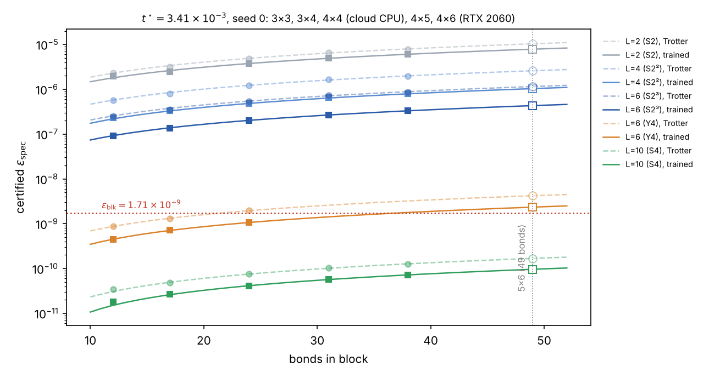

# Stage 7·8 결과 분석 (데스크탑 RTX 2060, 2026-10-11)

데이터는 다음과 같다.

- 데스크탑 결과: `results/4x5_*`, `results/4x6_*`, `bench_*`, `check_M_4x5_L4.json`
- 클라우드 보조 계산: `results/cloud/stage8/`. 3×3, 3×4, 4×4 비교 실행이다.

모두 $t^\star=3.41\times10^{-3}$, seed 0, $M$=4, 헤시안 전처리 L-BFGS, 인증 시작 벡터 2개로 계산했다.



## 0. 요약

1. **블록 요구 $\epsilon_\text{blk}=1.71\times10^{-9}$를 만족하는 것은 $L$=10뿐이다.** 학습 없이 S4 초기값만으로도 만족한다.
   - S4: 20큐비트 1.0e-10, 24큐비트 1.3e-10 (14~17배 여유)
   - 학습 후: 5.8e-11, 7.1e-11 (24~30배 여유)
2. **$L$=2, 4, 6(S2 계열 초기값)은 학습 후에도 $\epsilon_\text{blk}$의 158~3500배이다.** 2차 공식의 한계이고, 학습은 이 격차를 메우지 못한다.
3. **학습 개선 배수는 크기와 거의 무관하다.** 9~24큐비트, 다섯 가지 크기에서 $L$=2: 1.2~1.3배, $L$=4: 2.4~2.5배, $L$=6: 2.6~2.8배, $L$=10: 1.8~2.0배였다. 오차 자체는 본드 수에 거의 비례한다. 그래서 5×6 결과를 꽤 믿을 만하게 예측할 수 있다(§3).
4. **새 후보 $L$=6 + Y4 초기값(3단 4차 공식)이 전체 비용으로는 가장 싸다.**
   - 같은 회로에서 S2³ 초기값보다 약 200배 좋다. 하지만 $t^\star$에서는 5×6 외삽이 학습 후 약 2.3e-9로 $\epsilon_\text{blk}$의 약 1.4배이다. 더 오래 학습해도, 층을 2개 더 붙여도($L$=8) 더 내려가지 않았다.
   - 블록 오차는 $t^5$에 비례하고(학습 후에도 정확히 그렇다), $\epsilon_\text{blk}$은 $t$에 비례한다. 그래서 $t$를 $0.925\,t^\star$로 조금 줄이면 $L$=6이 통과한다.
   - 그때 (블록 수 × CNOT)은 $L$=10, $t^\star$보다 **약 34 % 적다**. 학습 없는 Y4로는 23 %이므로, 학습이 약 11 %p를 더한다(§3.5).
5. **실행은 건강했다.**
   - 8개 조합 모두 완료, PASS. 인증 수렴, 시작 벡터 일치.
   - drift ≤3e-14, $\max|\delta|\le10^{-5}$ rad. 학습 위상 $\hat\phi\sim10^{-10}$.
   - held-out 차이 ≤0.3 %이므로 Stage 7(c) 기준을 충족한다. $M$=4는 20큐비트 `check_M`에서도 $M$=8과 0.01 % 이내였다.
6. **30큐비트 H200 예상 시간: 자기 헤시안이면 약 7.5시간, 옮긴 헤시안이면 약 5시간.** PLAN의 이전 추정은 1~3일이었다. 작은 패치 헤시안을 옮겨 써도 결과가 같다는 것을 4×4에서 확인했다(§5).

## 1. 실행된 것과 빠진 것

| 항목 | 상태 |
|---|---|
| Stage 8: `run_block` 4×5(20큐비트), 4×6(24큐비트), $L$=2·4·6·10 | 8개 모두 `complete`, 마지막 줄 PASS. 4×5 10분, 4×6 2시간 28분 |
| `bench.py` 4×5, 4×6 | 있음. 단 시간 값 일부가 틀렸다(§4.3) |
| `check_M.py` 4×5, $L$=4 | 있음. $M$=1·4·8이 0.01 % 이내 |
| Stage 7: `validate.py --device cuda` | **`results/validate_cuda0.json`이 저장소에 없다.** (a)(b)(d)의 GPU 확인 기록이 없다. (c)는 `run_block`의 held-out으로 대신 충족한다 |

## 2. 결과 (PLAN.md §8 표 1 형식)

**4×5 (20큐비트, 31본드)**

| $L$ (초기값) | CNOT | 깊이 | 파라미터 | $\epsilon_\text{spec}$ Trotter | $\epsilon_\text{spec}$ 학습 후 | 개선 | $/\epsilon_\text{blk}$ | $\epsilon_\text{rHS}$ | spectral/rHS |
|---|---|---|---|---|---|---|---|---|---|
| 2 (S2) | 186 | 24 | 17 | 6.55e-6 | 4.97e-6 | 1.32 | 2900 | 1.14e-6 | 4.4 |
| 4 (S2²) | 342 | 45 | 32 | 1.64e-6 | 6.47e-7 | 2.53 | 378 | 1.53e-7 | 4.2 |
| 6 (S2³) | 498 | 66 | 47 | 7.27e-7 | 2.70e-7 | 2.70 | 158 | 6.11e-8 | 4.4 |
| 10 (S4) | 810 | 108 | 77 | 1.02e-10 | 5.75e-11 | 1.77 | **0.034** | 1.05e-11 | 5.5 |

**4×6 (24큐비트, 38본드)**

| $L$ (초기값) | CNOT | 깊이 | 파라미터 | $\epsilon_\text{spec}$ Trotter | $\epsilon_\text{spec}$ 학습 후 | 개선 | $/\epsilon_\text{blk}$ | $\epsilon_\text{rHS}$ | spectral/rHS |
|---|---|---|---|---|---|---|---|---|---|
| 2 (S2) | 228 | 24 | 17 | 7.90e-6 | 6.01e-6 | 1.31 | 3500 | 1.27e-6 | 4.7 |
| 4 (S2²) | 420 | 45 | 32 | 1.97e-6 | 7.87e-7 | 2.51 | 460 | 1.71e-7 | 4.6 |
| 6 (S2³) | 612 | 66 | 47 | 8.77e-7 | 3.29e-7 | 2.67 | 192 | 6.84e-8 | 4.8 |
| 10 (S4) | 996 | 108 | 77 | 1.27e-10 | 7.15e-11 | 1.77 | **0.042** | 1.19e-11 | 6.0 |

## 3. 해석

### 3.1 차수가 결정한다

- S2$^r$ 계열은 $\epsilon\propto1/r^2$을 그대로 따른다. 4×5에서 6.5e-6 → 1.6e-6 → 7.3e-7로 1 : 1/4 : 1/9이다.
- 2차 공식으로 5×6에서 $\epsilon_\text{blk}$에 닿으려면 $r\approx50\sim80$, 즉 $L\approx100\sim160$이 필요하다. 학습 개선(최대 2.8배)으로는 어림없다.
- 4차 공식(S4, $L$=10)은 같은 $t$에서 오차가 약 7000배 작다. 그래서 학습 없이도 요구를 넘는다.
- 결론적으로 $t^\star$에서 이 블록을 결정하는 것은 **공식의 차수**이고, 같은 구조 안의 각도 학습은 그 위에 약 2배를 더한다.

### 3.2 학습 개선 배수는 크기와 무관하다

| 초기값 | 9q | 12q | 16q | 20q | 24q |
|---|---|---|---|---|---|
| $L$=2 (S2) | 1.17 | 1.27 | 1.30 | 1.32 | 1.31 |
| $L$=4 (S2²) | 2.50 | 2.36 | 2.54 | 2.53 | 2.51 |
| $L$=6 (S2³) | 2.78 | 2.62 | 2.68 | 2.70 | 2.67 |
| $L$=6 (Y4) | 2.01 | 1.80 | 1.86 | | |
| $L$=10 (S4) | 1.96 | 1.83 | 1.83 | 1.77 | 1.77 |

$L$=10의 배수가 1.96에서 1.77로 조금 줄지만 20큐비트 이후로는 평평하다. 30큐비트에서도 약 1.75배가 예상된다.

### 3.3 크기 의존성

- **오차는 본드 수에 거의 비례한다.** S4 기준 본드당 2.9e-12(9q), 3.3e-12(20q), 3.3e-12(24q)이다. 경계 효과로 작은 패치에서 조금 작다.
- **spectral/rHS 비율은 $\sqrt{\text{본드 수}}$로 커진다.** $L$=10에서 5.49 → 5.99이고, 이는 $\sqrt{38/31}=1.107$배와 맞는다. 5×6에서는 약 6.8이 예상된다. spectral은 본드 수에 비례하고 rHS는 그 제곱근에 비례하기 때문이다.

### 3.4 5×6(30큐비트, 49본드) 예측

큰 쪽 세 크기에 직선을 맞춰 외삽했다. 위 그림의 빈 표시가 예측값이다. Stage 10 결과와 비교할 예측이다.

| $L$ (초기값) | CNOT | $\epsilon_\text{spec}$ Trotter | $\epsilon_\text{spec}$ 학습 후 | 학습 후 $/\epsilon_\text{blk}$ |
|---|---|---|---|---|
| 2 (S2) | 294 | 1.0e-5 | 7.8e-6 | 4600 |
| 4 (S2²) | 552 | 2.6e-6 | 1.0e-6 | 600 |
| 6 (S2³) | 810 | 1.2e-6 | 4.3e-7 | 250 |
| 6 (Y4) | 810 | 4.2e-9 | 2.3e-9 | **1.4** |
| 10 (S4) | 1326 | 1.7e-10 | 9.6e-11 | **0.056** |

### 3.5 새 후보: $L$=6, Y4 초기값

- P1의 $L$=6은 3단 4차 공식 S2($wt$)S2($(1-2w)t$)S2($wt$), $w=1/(2-2^{1/3})$을 포함한다(`--init Y4`).
- S2³에서 출발하면 학습이 2차 공식 근처의 극소에 머문다. Y4에서 출발하면 같은 회로가 약 190~210배 좋다.
- Y4의 오차 상수는 S4의 약 26배라서 5×6에서 학습 후 약 2.3e-9가 된다. $\epsilon_\text{blk}$보다 약 1.4배 크다. 외삽 근거가 12~24본드 세 점뿐이라 ±20~30 %의 불확실성이 있다.
- 더 내려갈 여지를 확인했다(`results/cloud/stage8/y4ext_*`).
  - 정체 규칙 없이 학습해도 같은 값에서 scipy가 수렴 판정을 했다.
  - $L$=8(Y4 + 항등 층 쌍)도 같은 값에 머물렀다. 같은 극소다.
- 따라서 이 ansatz 안에서 **$t^\star$ 고정이면** 최소 $L$은 10이다.

**$t$를 함께 고르면 결론이 바뀐다.** PLAN.md §1.2는 블록 비용이 $t$에 거의 무관하다고 보고 $t$를 LR이 허용하는 최댓값으로 정했다. 하지만 필요한 $L$은 $t$에 따라 계단처럼 바뀐다.

- 블록 오차는 4차 공식에서 $t^5$에 비례한다. 3×4에서 $t$=0.9·0.8 $t^\star$로 확인했고, 비율이 0.590·0.328로 $0.9^5$·$0.8^5$와 정확히 같았다. 학습 후 회로도 같다. 즉 학습 개선 배수는 $t$와 무관하다.
- $\epsilon_\text{blk}=\epsilon/(3m)$이고 $m\propto1/t$이므로 $\epsilon_\text{blk}\propto t$이다.
- 따라서 $L$=6 Y4가 통과하는 최대 $t$는 $t^\star\times(\epsilon_\text{blk}/\epsilon_{L6})^{1/4}$이다. $t<t^\star$이면 LR 오차는 줄어들 뿐이므로 허용된다.

| 선택 (5×6) | 통과하는 최대 $t$ | 블록 수 $m$ | CNOT × $m$ (상대) |
|---|---|---|---|
| $L$=10 S4 (학습 전후 모두) | $t^\star$ (LR 상한) | $m^\star$ | 1326 $m^\star$ |
| $L$=6 Y4, 학습 없음 | $0.80\,t^\star$ | $1.25\,m^\star$ | 1015 $m^\star$ (**−23 %**) |
| $L$=6 Y4, 학습 후 | $0.925\,t^\star$ | $1.08\,m^\star$ | 876 $m^\star$ (**−34 %**) |

- 외삽 오차 ±30 %는 $t$에 $1.3^{1/4}\approx1.07$배로만 들어간다. 그래서 절감 폭은 약 30~37 %로 견고하다.
- 이것이 이번 실험에서 **변분 학습이 전체 비용을 줄이는 구체적인 경로**이다. 같은 $L$에서 오차를 약 1.9배 줄이면, 4차 오차의 $t^5$ 의존성 때문에 허용 $t$가 $1.9^{1/4}\approx1.17$배 커진다.
- $L$=10은 $t^\star$에서 10~18배 여유가 남지만 LR 상한 때문에 $t$를 더 키울 수 없다. 그 여유는 쓰이지 않는다.

### 3.6 학습 동역학

- 전처리 효과가 컸다. 반복 수는 $L$=2 3~5회, $L$=4 40~42회, $L$=6 65~72회, $L$=10 52~53회였다.
- $L$=6(S2³)의 헤시안에는 음의 고윳값이 7~9개 있다(약 −5~−8). 즉 S2³ 점은 안장점이다. 전처리는 $|\lambda|$를 써서 이를 문제없이 처리했다.
- $L$=10의 헤시안은 $10^{19}$에서 $-10^{9}$까지 퍼져 있다. $J_0\approx2\times10^{-22}$로 정규화하기 때문이다. 그래도 개선 배수가 작은 패치와 같은 것을 보면 float64 잡음 바닥이 아직 지배하지 않는다.
- 4×5, $L$=2는 기울기 평가가 50회였다. 5회 반복 뒤 line search가 잡음 바닥에서 여러 번 실패했기 때문이다(`ABNORMAL`). 결과에는 영향이 없다.

### 3.7 인증

- 반복 수는 실행당 35~69회(최대 300), 모두 수렴했고 시작 벡터 두 개가 일치했다.
- $\max|\delta|$는 1e-10~1e-5 rad로 arcsin이 접히는 지점과 멀다.
- 학습 위상 $\hat\phi$는 1e-16~1e-9 rad로, 생성자가 traceless라는 예상과 맞다.

## 4. 성능

### 4.1 4×6(24큐비트) 시간 분해 (RTX 2060)

| $L$ | 기울기 1회 | 헤시안 | 학습 | 인증 (반복 수, 1회당) |
|---|---|---|---|---|
| 2 | 6.0 s | 1.4분 | 1.1분 | 7.9분 (227회, 2.1 s) |
| 4 | 11.0 s | 6.0분 | 7.7분 | 10.0분 (235회, 2.6 s) |
| 6 | 15.9 s | 12.7분 | 18.0분 | 11.7분 (227회, 3.1 s) |
| 10 | 25.5 s | **33.1분** | 24.2분 | 13.0분 (186회, 4.2 s) |

- $L$=10에서는 헤시안(기울기 78회)이 학습보다 오래 걸렸다.
- 유효 대역폭은 약 240 GB/s(최대치 336 GB/s의 70 %)이다. `forward_s`, `apply_H_s`로 확인했다.

### 4.2 30큐비트 H200 ×2 예상

24큐비트 실측에 다음 배율을 곱했다: 데이터 ×64, 본드 ×49/38, 대역폭비 1/14~1/17, GPU 2장 분담.

| $L$ | 기울기 1회 | 헤시안(자기) | 학습 | 인증 |
|---|---|---|---|---|
| 2 | 15~18 s | 0.1 h | 0.05 h | 0.4 h |
| 4 | 27~32 s | 0.3 h | 0.4 h | 0.5 h |
| 6 | 39~47 s | 0.6 h | 0.9 h | 0.6 h |
| 10 | 62~75 s | 1.6 h | 1.2 h | 0.7 h |
| 합 | | 2.6 h | 2.5 h | 2.2 h |

- 자기 헤시안이면 약 7.5시간, 옮긴 헤시안이면 약 5시간이다. $L$=6 Y4를 더하면 약 1~1.5시간이 추가된다.
- **헤시안 옮기기 검증**(4×4 대상, `results/cloud/stage8/scan_4x4.json`): 3×4나 3×3의 헤시안으로 전처리해도 최종 $J$와 $\epsilon_\text{spec}$이 자기 헤시안과 3~4자리까지 같았고 반복 수도 거의 같았다.

  | 경우 | 자기 헤시안 | 옮긴 헤시안 |
  |---|---|---|
  | $L$=6 S2³ | 66회 | 61~63회 |
  | $L$=6 Y4 | 36회 | 37~38회 |
  | $L$=10 | 54회 | 62~63회 |

### 4.3 측정상의 문제 (수정함)

- 데스크탑 시계가 3~22초씩 뒤로 자주 돌아갔다. 로그에 `Hessian column 1/17 (-11s)` 같은 줄이 있다.
- 코드가 경과 시간을 `time.time()`으로 쟀기 때문에 `bench.py`의 짧은 측정이 틀렸다. `cert_matvec_s`가 −18.6 s로 나왔고, `adjoint_s` 29 s는 실제 학습의 상태당 6.4 s와 맞지 않았다.
- 긴 총계는 몇 % 이내로 맞다.
- 모든 경과 시간을 `time.perf_counter()`로 바꿨다. `bench.py`의 짧은 커널 측정에는 예열 호출을 넣었다. 결과 JSON의 `env.gpu_peak_GB`에 GPU 최대 메모리를 기록하게 했다.

## 5. Stage 9·10 권장

1. **먼저 할 것 (데스크탑, 선택):**
   - `validate.py --device cuda` 결과(`results/validate_cuda0.json`)를 커밋한다.
   - $L$=6 Y4를 24큐비트에서 한 번 돌려 외삽을 확인한다(약 45분).

     ```bash
     python scripts/run_block.py --patch 4x6 --t 3.41e-3 --L 6 --init Y4     # results/4x6_s0_t0.00341_L6_Y4.json
     ```
2. **H200 Stage 9:** `python scripts/bench.py --n 26 28 30 --devices cuda:0 cuda:1`. 시간 측정을 고쳤으므로 이제 값이 믿을 만하다.
3. **H200 Stage 10:**

   ```bash
   python scripts/run_block.py --patch 5x6 --t 3.41e-3 --L 2 4 6 10 --precond 4x5 --devices cuda:0 cuda:1
   python scripts/run_block.py --patch 5x6 --t 3.41e-3 --L 6 --init Y4 --precond 4x5 --devices cuda:0 cuda:1
   # 선택: L=6 Y4가 실제로 통과하는 t에서 직접 인증 (외삽 대신)
   python scripts/run_block.py --patch 5x6 --t 3.15e-3 --L 6 --init Y4 --precond 4x5 --eps-blk 1.58e-9 --devices cuda:0 cuda:1
   ```

   - `--precond 4x5`는 20큐비트에서 헤시안을 구한다. H200에서 몇 분이면 되고 2.6시간을 아낀다.
   - 결과는 §3.4 예측과 비교한다. 예측과 크게 다르면(2배 이상) 그 자체가 중요한 결과다. 2D에서 크기 의존성이 바뀌는 것이기 때문이다.
   - $t$=3.15e-3은 $0.925\,t^\star$이고, 이때 $\epsilon_\text{blk}=1.71\times10^{-9}\times0.925\approx1.58\times10^{-9}$이다. $t^\star$에서 Y4를 잰 뒤 $t^5$로 환산해도 같은 결론이 나오므로 이 실행은 확인용이다.
4. **결정할 것:**
   - (a) $L$=6 Y4를 주 실험에 넣을지(권장)
   - (b) 동작점을 "$t^\star$ 고정"에서 "$L$마다 통과하는 최대 $t$"로 바꿔 보고할지. 이 경우 PLAN.md §1.2의 "$t$는 클수록 유리하다"는 가정을 고쳐야 한다(§3.5).
